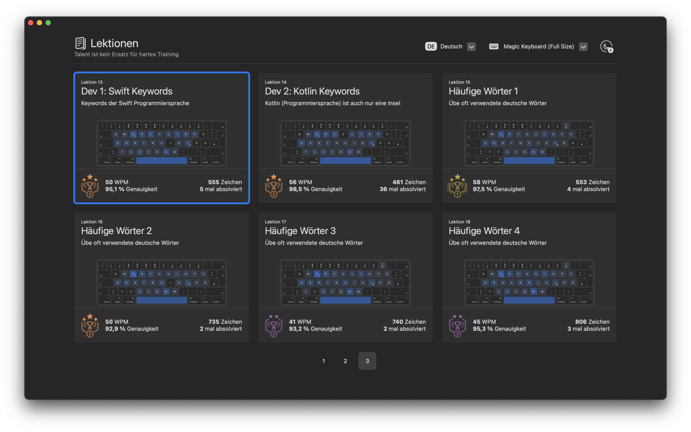
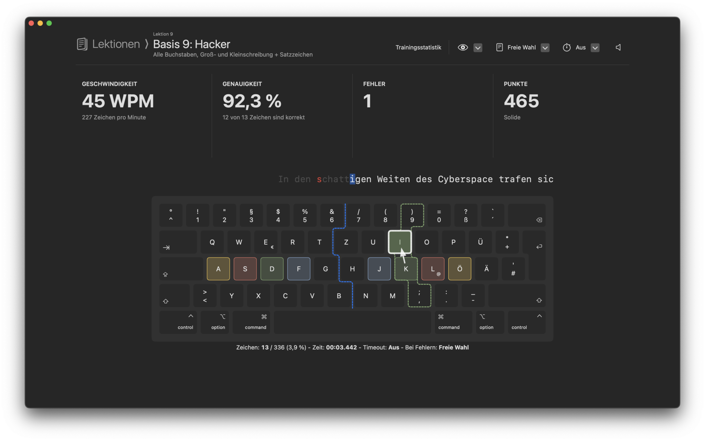
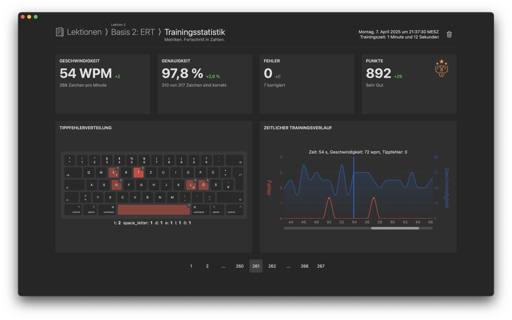

# Features

## Lektionen

Für jede Eingabequelle (Tastaturlayouts) enthält die App Lektionen mit ansteigendem Schwierigkeitsgrad, die dich Schritt für Schritt zum Ziel führen. Jede Kachel repräsentiert eine Lektion mit den wichtigsten Informationen und deinem bisherigen Fortschritt.

Wichtige Elemente der Übersicht:

- **Lektionsname und Kurzbeschreibung:** Jede Lektion hat einen spezifischen Fokus, z. B. Grundstellungen, Zahlen oder spezielle Buchstabenkombinationen.
- **Fortschrittsindikatoren:** Geschwindigkeit: Deine durchschnittliche Tippgeschwindigkeit in WPM (Wörter pro Minute).
- **Genauigkeit:** Der Prozentsatz korrekt eingegebener Zeichen.
- **Absolvierte Durchläufe:** Wie oft du diese Lektion bereits trainiert hast.
- **Darstellung der Tastaturabdeckung:** Hervorhebung der zu trainierenden Tastenbereiche für eine schnelle Orientierung.
- **Belohnungssystem:** Auszeichnungen (z. B. Bronze-, Silber- oder Goldmedaille) motivieren dich, deine Leistung zu steigern.

Die Navigation ermöglicht es dir, zwischen mehreren Seiten der Lektionsliste zu wechseln, während ein ansprechendes Design und intuitive Bedienung für eine optimale Lernerfahrung sorgen.

Mit dieser Übersicht kannst du deine nächsten Trainingsziele schnell auswählen und deine Fortschritte stets im Blick behalten.

## Tipptraining

Perfektioniere deine Tippgeschwindigkeit und Genauigkeit mit unserem interaktiven Tipptraining. Die App ermöglicht dir, gezielt Lektionen zu üben, die auf deine Bedürfnisse abgestimmt sind.

Damit du optimal lernen kannst, stehen dir zahlreiche optionale Hilfen zur Verfügung:

- Virtuelle Tastatur mit Hervorhebung der aktuell erforderlichen Taste.
- Grundposition-Anzeige, um die korrekte Handhaltung sicherzustellen.
- Farbig markierte Fingerzonen, die wahlweise statisch (immer sichtbar) oder dynamisch (nur die aktuelle Zone) angezeigt werden.
- Farbige Handzonen-Trennlinie, die klar zwischen den Tasten der linken und rechten Hand unterscheidet.

Erlebe ein individuell anpassbares Training, das Spaß macht und deine Fortschritte messbar macht!

## Trainingsergebnisse

Nach jeder abgeschlossenen Lektion bietet die App eine detaillierte Statistik, um deinen Fortschritt zu analysieren und zu optimieren.

Folgende Daten werden dir übersichtlich dargestellt:

- **Geschwindigkeit:** Deine Tippgeschwindigkeit in Wörtern pro Minute (WPM) sowie die Veränderung im Vergleich zur vorherigen Lektion.
- **Genauigkeit:** Der Prozentsatz korrekt getippter Zeichen, inklusive der Anzahl der richtigen und insgesamt getippten Zeichen.
- **Tippfehler:** Die Anzahl der Fehler, inklusive Korrekturen während des Trainings.
- **Punkte:** Eine Bewertung deiner Leistung basierend auf Geschwindigkeit, Genauigkeit und Fehlern – ergänzt durch eine motivierende Bewertungsskala (z. B. „Sehr Gut“).

Zusätzlich werden zwei visuelle Hilfen angeboten:

1. **Tippfehlerverteilung:** Eine interaktive Darstellung, die zeigt, welche Tasten besonders fehleranfällig waren.
2. **Zeitlicher Trainingsverlauf:** Ein Diagramm, das Geschwindigkeit (blaue Linie) und Tippfehler (rote Linie) über die Trainingszeit hinweg darstellt, um Schwachstellen und Stärken zu erkennen.

Mit diesen Analysen kannst du gezielt an deinen Fähigkeiten arbeiten und deinen Fortschritt Schritt für Schritt verbessern!

## Tolle Bedienung

Ten Fingers bietet sich sehr gut mit der Tastatur damit Sie die Hände auch zwischen den Trainings auf der Tastatur lassen können. Andererseits wurde auch die Steuerung mit der Maus und dem Trackpad nicht vernachlässigt. Ich habe großen Wert darauf gelegt, dass beide Eingabemethoden nahtlos zusammenarbeiten und Sie unabhängig von Ihren Gewohnheiten stets flüssig navigieren können. Egal, ob Sie ausschließlich die Tastatur nutzen, zwischen Maus und Tastatur wechseln oder beide gleichzeitig verwenden – die App passt sich Ihren Bedürfnissen an – nicht umgekehrt!

## Native

Ten Fingers ist eine native macOS App. Sie besteht zu 100% aus von Hand geschriebenen und optimiertem Swift Code unter Verwendung der Frameworks SwiftUI und AppKit. Sie bekommen dadurch eine optimale Performance, eine geringe Dateigröße und eine perfekte Integration ins macOS-Ökosystem.

## App Store + Sandbox

Ten Fingers wird über den App Store verteilt und in einer sicheren Sandbox ausgeführt, die Ihre Daten schützt und ungewollte Zugriffe verhindert. Apple prüft jede Version vor der Veröffentlichung in einem App-Review. In diesem werden Sicherheitsprüfungen, die Einhaltung der Apple-Richtlinien und die Code-Signierung überprüft.

Sie profitieren dadurch von einer einfacher Installation, automatischen Updates und einem reibungslosen Erlebnis – sicher und bequem, wie es sein sollte.

Das sind die Xcode Einstellungen für die App Sandbox:

Wie Sie sehen ist Ten Fingers mit den minimal möglichen Berechtigungen implementiert.

## Maximaler Datenschutz

Ich habe kein Interesse daran, Sie oder andere auszuspionieren. Ihre Trainingsdaten werden lokal gespeichert und es erfolgt keine Übertragung auf andere Geräte. Um dies sicherzustellen, habe ich bewusst die Rechte innerhalb der Sandbox eingeschränkt, sodass Sie darauf vertrauen können, dass keine Daten nach außen gelangen oder nachgeladen werden.

Das folgende steht im App Store im App-Datenschutz Bereich.

Und genau so soll es auch bleiben.

## Keine Werbung

Dieses Projekt soll Spaß machen! Für mich (als Entwickler) und vor allem Ihnen! Deshalb ist Ten Fingers komplett werbefrei.

Lade Ten Fingers und starte beginne das Training!

Erfordert macOS 14.0 oder neuer.

