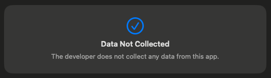

# Features

## Great Usability

Ten Fingers works seamlessly with the keyboard, allowing you to keep your hands on it even between training sessions. At the same time, mouse and trackpad controls are fully supported. I’ve focused on ensuring both input methods work together effortlessly, enabling smooth navigation no matter your preferences. Whether you use the keyboard exclusively, switch between the mouse and keyboard, or use both at once, the app adapts to your needs – not the other way around!

## Native

Ten Fingers is a native macOS app. It is crafted entirely from hand-written and optimized Swift code, utilizing the SwiftUI and AppKit frameworks. This ensures optimal performance, a small file size, and seamless integration into the macOS ecosystem.

## App Store + Sandbox

Ten Fingers is distributed through the App Store and runs in a secure sandbox, protecting your data and preventing unauthorized access. Apple reviews every version before its release through an App Review process. This includes security checks, compliance with Apple guidelines, and code signing verification.

This means you benefit from easy installation, automatic updates, and a seamless experience – safe and convenient, just as it should be.

Here are the Xcode settings for the App Sandbox:

As you can see, Ten Fingers is implemented with the minimal permissions possible.

## Maximum Privacy

I have no interest in spying on you or anyone else. Your training data is stored locally, and no data is transferred to other devices. To ensure this, I’ve deliberately restricted permissions within the sandbox, so you can trust that no data is sent externally or fetched from outside sources.

The following is listed in the App Store under the App Privacy section.

And I am committed to ensuring it stays that way.

## No Ads

This project is meant to be fun! For me (as the developer) and, most importantly, for you! That’s why Ten Fingers is completely ad-free.
